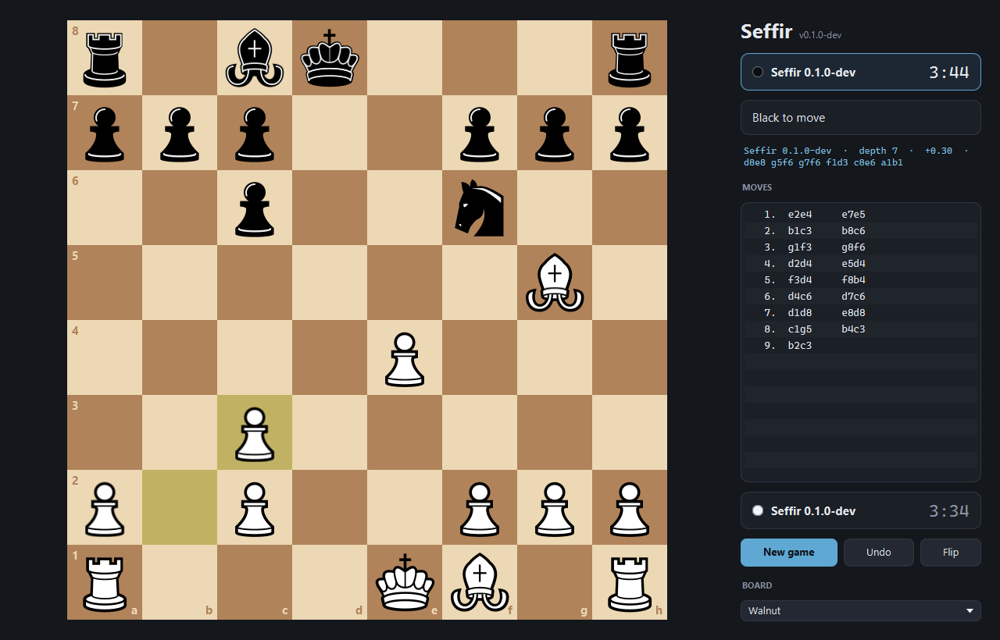
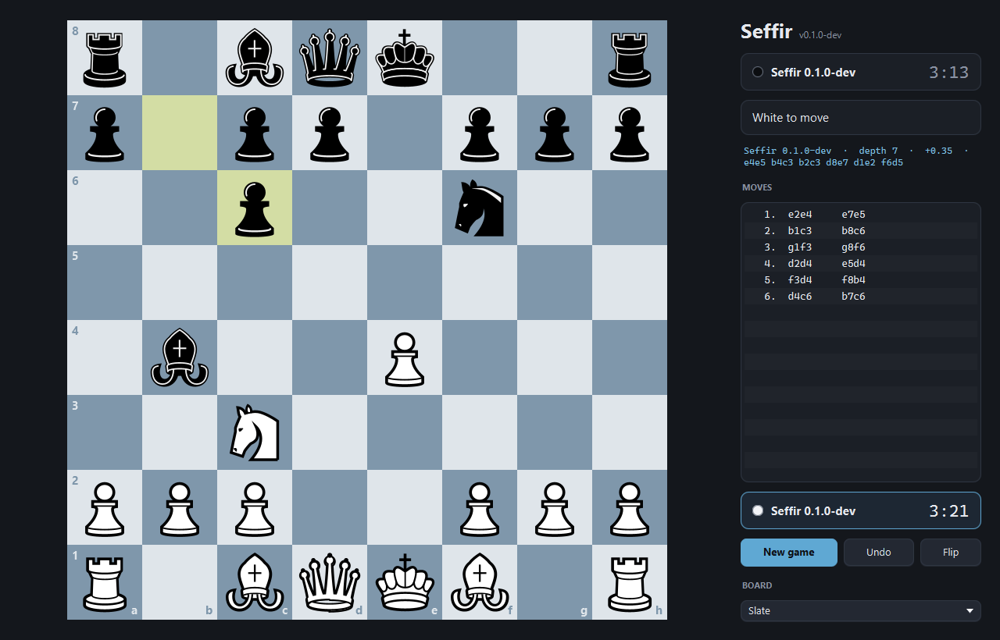
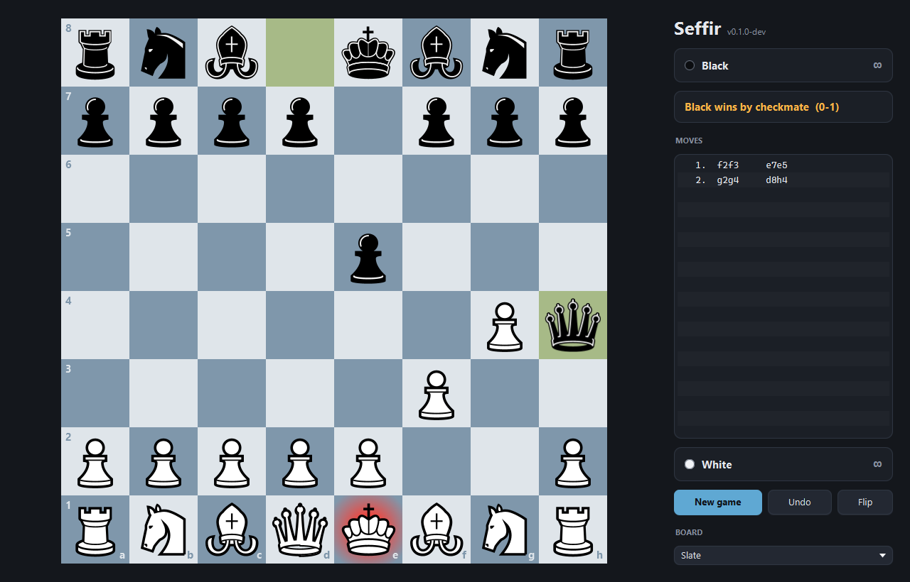
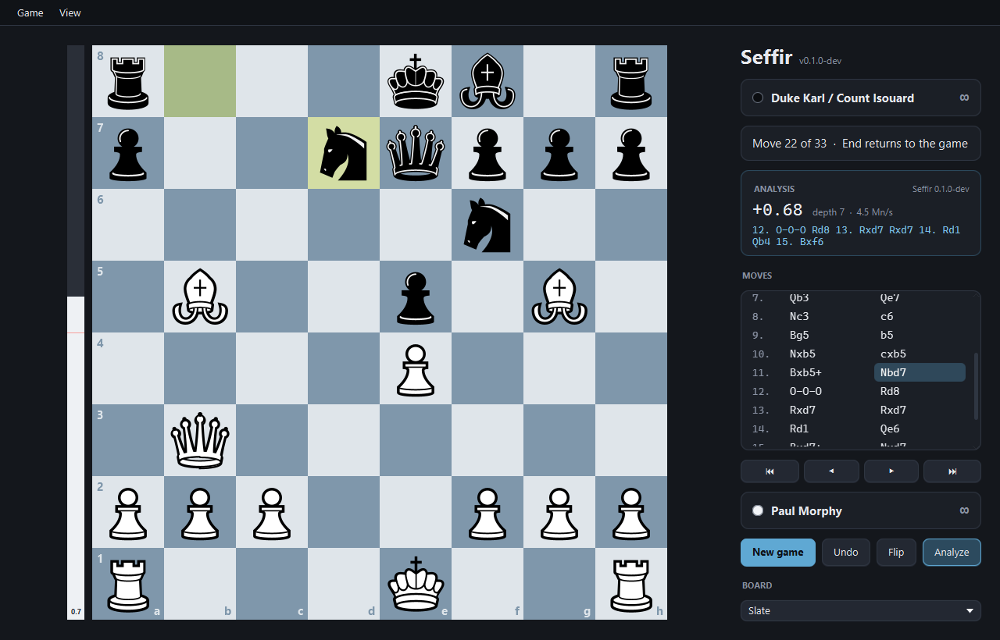
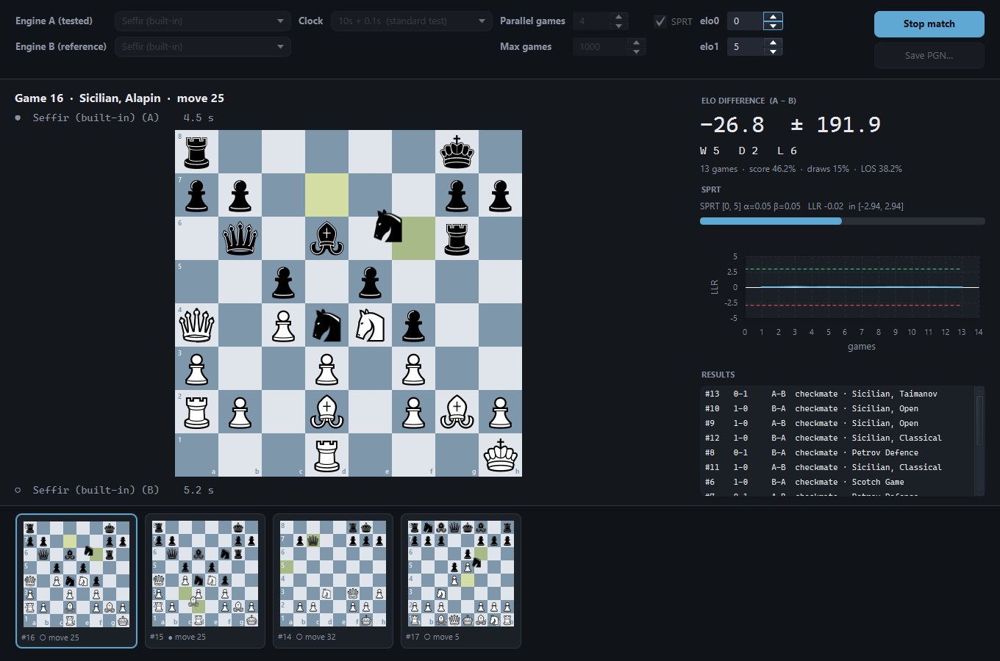

# Seffir

A chess engine written from scratch in Java 21, with a native JavaFX desktop GUI.

[](https://github.com/Sefirr-dot/Seffir-chess-engine/actions/workflows/ci.yml)

> **Status:** playable engine and a complete desktop app — play, analyse, and run engine matches with live SPRT.
> Next: making the engine stronger, every change proven in the arena. See the [roadmap](docs/ROADMAP.md).



<table>
  <tr>
    <td></td>
    <td></td>
  </tr>
  <tr>
    <td align="center"><sub>Live engine output: depth, evaluation and principal variation</sub></td>
    <td align="center"><sub>Game end detection with the mated king highlighted</sub></td>
  </tr>
  <tr>
    <td colspan="2"></td>
  </tr>
  <tr>
    <td colspan="2" align="center"><sub>Morphy's Opera Game (1858) opened from PGN and analysed at move 11: Seffir finds Morphy's own <code>12. O-O-O Rd8 13. Rxd7 Rxd7 14. Rd1</code></sub></td>
  </tr>
</table>

## Features

- **Bitboard board** with mailbox, incremental Zobrist hashing, repetition and fifty-move detection.
- **Legal move generation** validated against the standard perft suite (~27M nodes/s).
- **Search:** negamax alpha-beta, iterative deepening, quiescence, check extension, MVV-LVA ordering.
- **Evaluation:** material + piece-square tables with a tapered king.
- **UCI:** `position`, `go` (depth / nodes / movetime / clock / infinite), `stop`, plus `d` to print the board.
- **Desktop app (JavaFX):** vector pieces, drag & drop, move hints, promotion chooser, three board themes; play
  against the built-in engine or any UCI executable (Stockfish…) with Fischer clocks and a live thinking line.
- **Notation:** SAN with minimal disambiguation, PGN reading (comments, variations, NAGs, several games) and writing.
- **Match arena:** engine-vs-engine games played live in parallel, opening book with colour-reversed pairs, Elo with
  error bars, likelihood of superiority and an SPRT that stops the match on its own.

## Architecture

```
Seffir-chess-engine/
├── engine-core/   Board (bitboards), move generation, search, evaluation. Zero dependencies.
├── engine-uci/    Standalone UCI executable on top of engine-core.
└── gui/           JavaFX desktop app. Runs engines as external UCI processes.
```

The GUI never calls the engine in-process: it launches it and talks [UCI](https://www.wbec-ridderkerk.nl/html/UCIProtocol.html),
the same way Arena, CuteChess or Lichess bots do. That means the GUI can load any UCI engine (e.g. Stockfish for comparison),
and the engine runs in any UCI-compatible GUI or tournament manager.

## Build

Requires JDK 21+. Maven is provided through the wrapper.

```bash
./mvnw verify                       # build + all tests
./mvnw -pl gui -am javafx:run       # launch the desktop app (after `./mvnw install` once)
```

## Desktop app

`./mvnw package` also builds `gui/target/seffir-gui.jar`; start it with `scripts/seffir-gui.bat` (or `java -jar`).
It opens a game against Seffir with you as White. **New game** lets you pick your colour, the opponent (human,
the built-in Seffir, or any UCI engine executable such as Stockfish) and the time control (1+0 up to 30+0, or
unlimited). Undo against an engine takes back your move and its reply.

Drag and drop or click-click to move, legal moves are hinted, promotions open a piece chooser. The move list is in
standard algebraic notation; click a move (or use the arrow keys) to replay the game.

The **Game** menu opens and saves PGN files, copies the game as PGN or the position as FEN, and pastes either from the
clipboard: a pasted FEN starts a game from that position against the current opponent.

**Analyze** (<kbd>A</kbd>) runs the engine on the position on the board — including any earlier move you are
replaying — with an evaluation bar and the best line in SAN. To keep games fair it is available between humans and
after a game ends, never while playing against an engine.

| Shortcut | Action | Shortcut | Action |
|---|---|---|---|
| <kbd>Ctrl</kbd>+<kbd>N</kbd> | New game | <kbd>Ctrl</kbd>+<kbd>O</kbd> / <kbd>Ctrl</kbd>+<kbd>S</kbd> | Open / save PGN |
| <kbd>Ctrl</kbd>+<kbd>Z</kbd> | Take back | <kbd>Ctrl</kbd>+<kbd>Shift</kbd>+<kbd>C</kbd> | Copy PGN |
| <kbd>F</kbd> | Flip board | <kbd>Ctrl</kbd>+<kbd>V</kbd> | Paste PGN or FEN |
| <kbd>A</kbd> | Analysis on / off | | |
| <kbd>←</kbd> <kbd>→</kbd> | Previous / next move | <kbd>Home</kbd> <kbd>End</kbd> | Start / live position |

Piece set: [Chessnut](https://github.com/LexLuengas/chessnut-pieces) by Alexis Luengas, Apache 2.0.

## Match arena



**Tools → Match arena…** (<kbd>Ctrl</kbd>+<kbd>M</kbd>) plays engine A against engine B — the built-in Seffir, any UCI
executable, or a `seffir.jar` built from another branch. Games run in parallel, each opening twice with colours
swapped. The featured game is shown full size (click a thumbnail to switch), and after every game the panel updates
the Elo difference with its 95% interval, the likelihood of superiority and the SPRT log-likelihood ratio, which ends
the match as soon as it crosses a bound. All games can be saved as PGN.

The screenshot shows why this matters: Seffir against itself after 13 games reads −26.8 ± 191.9 Elo — pure noise that
a handful of games cannot tell apart from a real change. The SPRT keeps testing until the evidence is conclusive.

## Play against it in another GUI

`./mvnw package` produces a self-contained `engine-uci/target/seffir.jar`. In any UCI GUI
([Arena](http://www.playwitharena.de/), [CuteChess](https://cutechess.com/), [BanksiaGUI](https://banksiagui.com/)…)
add a new engine pointing at `scripts/seffir.bat` (Windows) or `scripts/seffir.sh` (Linux/macOS).

Or talk to it directly:

```text
$ java -jar engine-uci/target/seffir.jar
position startpos moves e2e4
go movetime 2000
info depth 1 score cp 0 nodes 21 ... pv e7e5
...
bestmove e7e5
```

## Contributing

See [CONTRIBUTING.md](CONTRIBUTING.md) for the branching model and commit conventions.

## License

[MIT](LICENSE)
